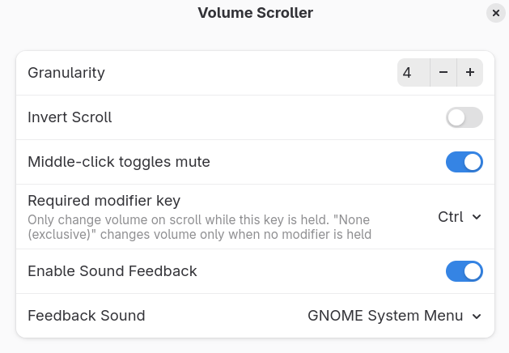

# Volume Scroller for GNOME Shell

Scroll over the GNOME top bar to adjust the volume. Middle-click the top bar to toggle mute. This fork adds configurable sound feedback using the same sound event as the GNOME System Menu by default.

The original [Volume Scroller by francislavoie](https://github.com/francislavoie/gnome-shell-volume-scroller) is available on [GNOME Shell Extensions](https://extensions.gnome.org/extension/5904/volume-scroller/) and was forked from [trflynn89's Volume Scroller](https://github.com/trflynn89/gnome-shell-volume-scroller).

## Settings



- **Granularity** sets the volume step per scroll tick (default 5%).
- **Invert Scroll** reverses the scroll direction.
- **Middle-click toggles mute** enables the mute shortcut on the top bar.
- **Required modifier key** controls when scrolling adjusts volume.
  - **None** (default) requires no specific modifier.
  - **Ctrl**, **Alt**, **Shift**, or **Super** requires the selected key to be held.
  - **None (exclusive)** passes scrolling through to the panel when any of those four keys is held. Lock keys such as Num Lock and Caps Lock are ignored.
- **Enable Sound Feedback** plays a sound when scrolling changes the volume. It is enabled by default. Turn it off to adjust volume silently.
- **Feedback Sound** selects **GNOME System Menu** (default), **Bell**, **Information**, or **Message** from the system sound theme.

Sound feedback follows GNOME's system event sound setting and is skipped while audio is already playing.

To set the modifier from the command line, run:

```sh
gsettings --schemadir ~/.local/share/gnome-shell/extensions/volume_scroller@francislavoie.github.io/schemas set org.gnome.shell.extensions.volume-scroller modifier-key none-exclusive
```

## Manual Installation

If you have a release ZIP from [this fork](https://github.com/greenfinch628/gnome-shell-volume-scroller/releases), install it with:

```sh
gnome-extensions install --force volume_scroller@francislavoie.github.io.*.shell-extension.zip
```

To build and install from a checkout of this fork, run:

```sh
uuid=volume_scroller@francislavoie.github.io
gnome-extensions pack --force "$uuid"
gnome-extensions install --force "$uuid.shell-extension.zip"
```

Log out and back in to load the extension. On X11, you can instead press **Alt+F2** and run **r**.

## Contributing

When running the extension directly from a checkout, recompile the settings schema after changing it.

```sh
glib-compile-schemas volume_scroller@francislavoie.github.io/schemas/
```

For Wayland testing, see the [GNOME guide to testing extensions](https://gjs.guide/extensions/development/creating.html#testing-the-extension).

See [CHANGELOG.md](CHANGELOG.md) for changes in this fork.
